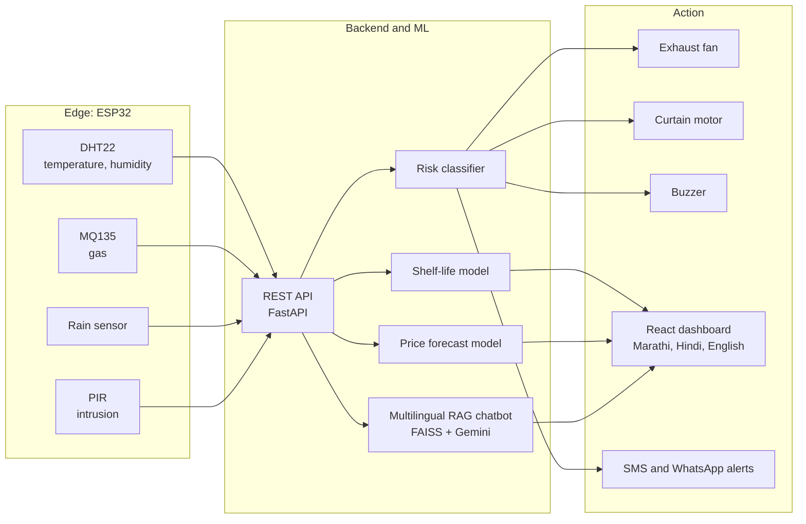

 

 

## Overview

I am a Computer Engineering (Data Science) student and former Data Science intern at **Celebal Technologies**, based in Maharashtra, India.

Most machine learning work stops at a notebook. I care about the part after that: the data pipeline underneath a model, the API around it, the interface in front of it, and the hardware feeding it when the problem is physical. That is why my projects span **Data Science, NLP, Computer Vision, full-stack web and embedded IoT**, and why many of them are built for people who are rarely the target user of software: farmers and the visually impaired.

<table>
<tr>
<td width="50%" valign="top">

**Focus areas**

- Predictive modelling and explainable ML
- NLP, retrieval-augmented generation and knowledge graphs
- Computer vision and medical imaging
- Industrial IoT and edge-to-cloud systems
- Multilingual, accessible product design

</td>
<td width="50%" valign="top">

**Right now**

- Building **OnioRakshak**, my final-year IoT and ML system
- Writing an IEEE conference paper on it
- Developing a hybrid **RAG + Knowledge Graph** chatbot
- Studying **knee MRI abnormality detection** from first principles
- Open to Data Science, ML and software engineering roles

</td>
</tr>
</table>

 

## Flagship: OnioRakshak

> An end-to-end smart storage system that watches stored onions, predicts how long they will last and what they will sell for, and acts on its own when conditions turn risky.

Onion losses in storage come from heat, humidity, gas build-up, moisture and pests, and farmers usually find out after the damage is done. OnioRakshak closes that loop: sensors measure, models predict, actuators respond, and the farmer is informed in their own language.

| Layer | Decisions |
|---|---|
| Sensing | ESP32 reads temperature, humidity, gas, rain and intrusion, with processing at the edge |
| Prediction | Separate models for shelf life, market price and storage risk, packaged as `.joblib` artefacts |
| Assistant | Hybrid chatbot: rule-based layer first, Gemini-powered RAG over a curated onion knowledge base as fallback; answers in the language the farmer writes in, with voice input and output |
| Interface | React (Vite) and Tailwind, farmer-first design, whole interface translated into Marathi, Hindi and English |
| Engineering | Protected `main`, one feature branch per module, every change through a pull request |

 

## Selected work

### Data Science

<table>
<tr>
<td width="33%" valign="top">

**[Customer Churn Prediction](https://github.com/mahimav11/customer_churn_prediction)**

Predicts which customers will leave and explains each prediction, so a retention team knows what to act on, not just who is at risk.

`XGBoost` `SHAP` `Flask`

</td>
<td width="33%" valign="top">

**[Sentiment Analysis on Product Reviews](https://github.com/mahimav11/sentiment_analysis_nlp)**

Benchmarks a classical TF-IDF baseline against BERT on review text, with an interactive demo.

`TF-IDF` `BERT` `Streamlit`

</td>
<td width="33%" valign="top">

**[Sales Forecasting and BI Dashboard](https://github.com/mahimav11/sales_forecasting_bi)**

Compares statistical and additive time-series models and delivers the result as a decision-ready dashboard.

`Prophet` `SARIMA` `Power BI`

</td>
</tr>
</table>

### Deep Learning and Applied AI

<table>
<tr>
<td width="50%" valign="top">

**[SightVoice](https://github.com/mahimav11/sightvoice_assistant)**

An assistive scene reader for visually impaired users. A PyTorch encoder-decoder (frozen ResNet50, Bahdanau attention, GRU decoder) describes an image, and speech synthesis reads the caption aloud through an accessibility-focused Streamlit interface built around WCAG 2.1.

`PyTorch` `Attention` `gTTS` `Streamlit`

</td>
<td width="50%" valign="top">

**Memory-Augmented Chatbot** (in progress)

Combines vector retrieval for static knowledge, a Neo4j knowledge graph for structured reasoning, long-term memory for personalisation, and LangGraph routing to live tools. Evaluated on context relevance, answer correctness and faithfulness.

`LangGraph` `FAISS` `Neo4j` `FastAPI`

</td>
</tr>
</table>

### IoT and Full-Stack

<table>
<tr>
<td width="33%" valign="top">

**MilkGuard**

An industrial-IoT system that flags milk adulteration from pH, turbidity and temperature readings, with a live monitoring dashboard. Team leader on a five-member project.

`Arduino` `NodeMCU` `Supabase` `React`

</td>
<td width="33%" valign="top">

**Farmer E-Diary**

A bilingual Marathi and English record-keeping app for farmers covering dairy, flour mill, onion sales, vet and feed, medical and diesel.

`Firebase` `SQLite` `JavaScript`

</td>
<td width="33%" valign="top">

**SmartFarm**

Deployed and customised an open-source agriculture platform: crop and fertiliser recommendation, plant disease detection and weather. Fixed a routing defect and set up authentication.

`Random Forest` `CNN` `Streamlit`

</td>
</tr>
</table>

 

## How I work

- **Ship the whole path.** A model is not finished until someone can use it. I build the API and interface around it.
- **Explain, do not only predict.** I favour interpretable output (SHAP, retrieval with sources) so users can trust and challenge results.
- **Design for the real user.** Language, literacy and connectivity shape the product, so I build multilingual and voice-first interfaces where they matter.
- **Disciplined version control.** Feature branches, small commits and reviewed pull requests, even on solo modules.
- **Be honest about data.** I label synthetic data as synthetic and keep real and generated datasets clearly separated.

 

## Toolbox

| Area | Tools |
|---|---|
| Machine learning | PyTorch, XGBoost, scikit-learn, BERT and Transformers, Prophet, SARIMA, SHAP |
| Generative AI | LangGraph, FAISS, Chroma, Neo4j, Gemini API, RAG pipelines |
| Backend | FastAPI, Flask, Node.js, Express, REST design |
| Frontend | React, Vite, Tailwind CSS, Streamlit |
| Data and storage | MongoDB, Firebase, Supabase, SQLite, Appwrite, Power BI |
| Embedded and IoT | ESP32, Arduino, NodeMCU, DHT22, MQ135, PIR |
| Practice | Git, GitHub flow, pull-request workflow |

 

## GitHub activity

 

## Connect

I am looking for roles where machine learning meets real engineering: Data Science, ML engineering and software development. If you are building something in agriculture, accessibility, IoT or applied AI, I would like to hear about it.

